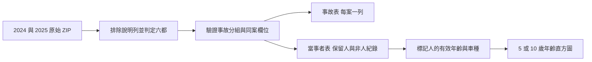

# A 部分實作與報告說明

負責人：莊鎧鴻／113403524。A 部分交接期限為 2026 年 11 月 27 日，全組交件日為 12 月 7 日。

專題預設分析範圍為 2021–2025 五年六都 A1／A2 資料。目前完成 2024–2025 年的前處理、兩張資料表、固定開發樣本、年齡直方圖與網站接入；其餘 2021–2023 年將依序完成清理、驗證與整合。其他組員的月別趨勢、時間圖、地圖、肇因圖及箱型圖仍由各自負責人完成。

## 以兩個事故樣本理解流程

教學樣本取自 2025 年，包含臺南兩列、臺中兩列。同組事故內的不同來源當事者各有紀錄，每列的全案死亡數會重複出現。

臺南第二列的來源屬性其實明示無或物（動物、堆置物），並不是一位已知的人。只看年齡 -1 和車種空白還無法判斷；正式程式已讀取屬性欄位。

| 來源組別 | 來源順位 | 原始年齡 | 原始車種 | 正式處理 |
| --- | --- | --- | --- | --- |
| 臺南案例 | 1 | 28 | 小客車 | 保留於事故關聯及年齡分析 |
| 臺南案例 | 2 | -1 | 未填 | 保留來源紀錄，標記非人，不進年齡圖 |
| 臺中案例 | 1 | 57 | 大貨車 | 保留於事故關聯及年齡分析 |
| 臺中案例 | 2 | 53 | 機車 | 保留於事故關聯及年齡分析 |

這組教學樣本整理後是兩件推定事故、四列來源當事者紀錄，其中三列是可分析的人的年齡。兩件事故各死亡一人，合計二人；把四列的死亡欄直接相加會得到錯誤的四人。



## 目前已完成的 2024–2025 年資料

| 年度 | 推定事故件數 | 來源當事者紀錄 | 有效年齡人次 |
| --- | --- | --- | --- |
| 2024 | 268,662 | 606,823 | 573,863 |
| 2025 | 273,821 | 618,553 | 585,193 |
| 合計 | 542,483 | 1,225,376 | 1,159,056 |

兩年包含 1,165,690 筆人的紀錄、59,686 筆明確非人紀錄。年度篩選可單選 2024、單選 2025 或兩年合計；日期涵蓋 2024-01-01 至 2025-12-31。2024 年為閏年，涵蓋日曆為 366 天，2025 年為 365 天。

## 可以報告的兩項觀察

1. 六都、全年、A1／A2、全部車種及 10 歲組距下，2024 年以 20–29 歲 最多，共 132,980 人次（23.17%）；2025 年以 20–29 歲 最多，共 128,536 人次（21.96%）。比例分母為各年度有效年齡人次。
2. 兩年合計的有效年齡中位數為 40 歲，中間約一半落在 26–55 歲；2024、2025 年中位數分別為 39、40 歲。這是當事者紀錄的分布，不能解讀為各年齡人口的肇事率。

兩年共 1,672 筆 0 歲或 100 歲以上有效年齡標為待覆核；排除後使用 1,157,384 人次。正式報告應說明是否採用此選項；切換年度、城市或車種後，樣本數與分布也會改變。

## 操作與交接

先從 [2024–2025 年資料 Release](https://github.com/Cammie0621/Traffic-Accident/releases/tag/data-2024-2025-v1) 下載完整清理資料並放入 data/processed，再啟動網站、選 participants 頁面。使用側邊年度、城市、事故類別，以及同頁車種控制；切換 5／10 歲組距，觀察年齡圖與有效筆數。待覆核值選項可比較 0 歲與高齡原值的影響。空選會顯示提示。

前處理入口是 scripts/preprocess.py；共用規則位於 utils/cleaning.py；年齡圖位於 components/age_distribution.py；頁面組裝位於 pages/4_participants.py。欄位與品質規則分別見 [資料字典](data_dictionary.md)及[清理紀錄](data_quality.md)。

```powershell
# 已在專案根目錄且虛擬環境啟用時
python scripts/preprocess.py --years 2024 2025
python -m unittest discover -s tests -v
python -m streamlit run app.py
```

完整生成檔保存在 data/processed；其他成員可先用 data/samples 的真實小樣本開發。載入器會優先用完整檔，再用開發樣本；都缺少才使用原本的模擬資料。開發樣本會在頁面明示。

## 程式講解順序

先說原始資料是當事者紀錄，再說為何傷亡要移到每案一列的事故表。接著解釋 regions 如何判定縣市、build_tables 如何驗證案件、clean_age 為何保留 0 與排除非人、summarize_ages 如何分組並核對加總。最後示範共用篩選和車種如何先選案、再選當事者。

scripts/inspect_data.py 僅供十筆樣本練習，其簡化規則不應替代正式批次程式。

## 限制

案件 ID 為推定、不是官方編號，依賴來源欄位與紀錄順序。年齡可能包含誤填，0 與高齡原值保留並標記待覆核；年齡圖不代表傷亡者年齡，也缺少人口、行駛里程與車流量等曝險分母。地點文字與警局核對不能取代行政界線空間驗證。
